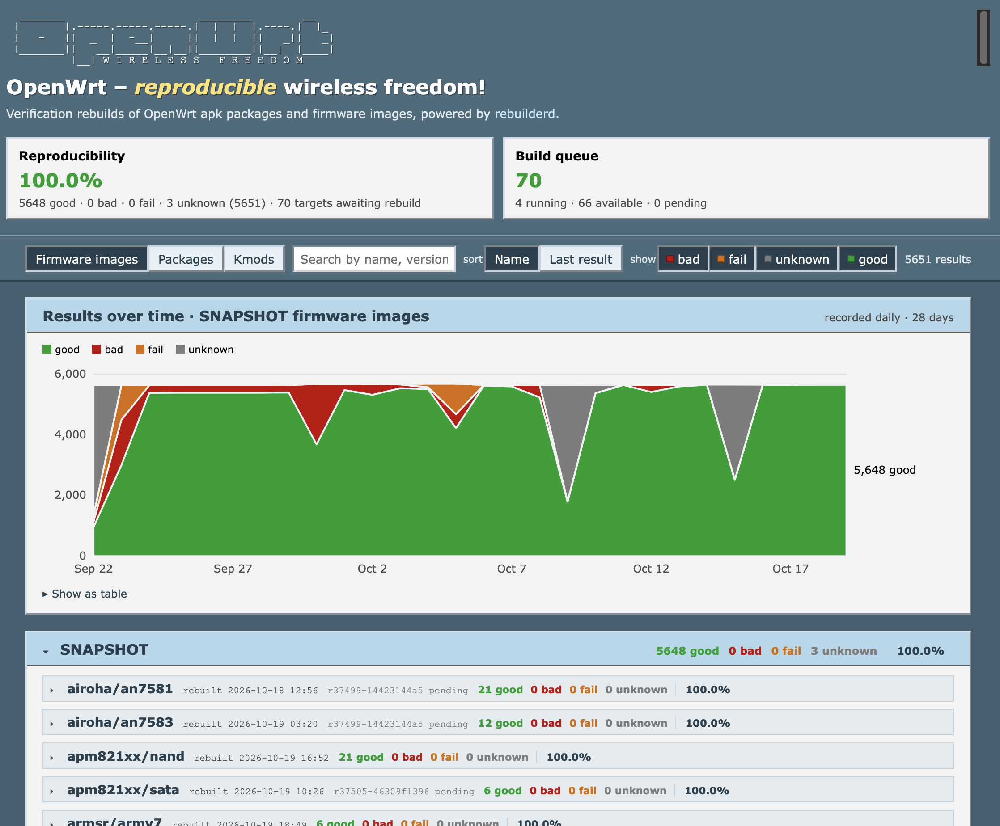
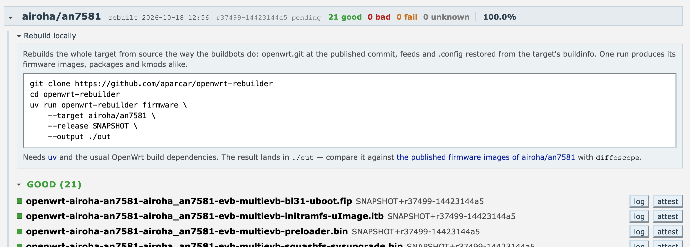

+++
title = "100% Reproducible OpenWrt"
date = "2026-10-19T17:09:51+02:00"
tags = ["openwrt", "reproducible-builds"]
draft = true
+++

This one has been cooking for a long time.

> tl;dr: OpenWrt (SNAPSHOT) is now 100% reproducible.

I planned a blog post like this back in 2019 when I first worked on the reproducibility of OpenWrt. The work was initially fueled by [h01ger], who kindly invited me to the [Reproducible Builds Summit 2019 in Marrakesh][marrakesh]. Discussions at the conference motivated me to look into *rebuilding firmware* rather than *building twice in different environments*. [Previous OpenWrt CI tests][old-ci] would build the same OpenWrt commit twice on two hosts with different times, different build paths, different GCC versions etc., whereas I wanted to check if I could fully recreate the officially published OpenWrt firmware images, therefore "re-building". In other words, it's a verification build to prove that whatever was published is really based on the source. While sources for this claim are missing, [kpcyrd] and I think the term *rebuilder* was coined at that conference.



### `openwrt-rebuilder`

So it needed a *rebuilder* for OpenWrt, which became [small software][openwrt-rebuidler] that consumes the OpenWrt `buildinfo` files. They contain the version (`version.buildinfo`), the build configuration (`config.buildinfo`) and the package feeds with their respective Git commit (`feeds.buildinfo`). When running, all files are put in place and parsed, and the official OpenWrt repository is cloned and built.

Initial versions of `openwrt-rebuilder` compared created artifacts on its own, ran [diffoscope] and were triggered via GitHub CI. Instead of doing the tracking via CI scripts, the tool was rewritten to be run by [`rebuilderd`][rebuilderd]. `rebuilderd` parses upstream, finds new versions and offers a queue for attached workers. The [integration bits are still pending][rebuilderd-openwrt], however I'm optimistic about getting this upstream eventually.

### Making sense of diffs

Diffoscope is an excellent tool. You hand it two files and it tells you what actually makes them different. A long list of archive formats and binary decoders is supported, so the output is as human readable as possible.

In cases where `diffoscope` doesn't know how to proceed, it shows a hexdump. While various AIs are surprisingly good at understanding hex dumps and figuring out what causes reproducibility issues, I'm not. As a consequence, I added APKv3 (not the Android stuff) [support][diffoscope-apk] to `diffoscope`, neatly printing issues. Once APK was supported, I struggled with further hexdumps and therefore added further [patches][diffoscope-mbr]. Below is an example of how `diffoscope` drills through the image and uncovers **GNU Build ID** as the villain.

<details>
<summary>diffoscope output</summary>

```diff
gzip: /tmp/rebuilderdaGqkBb/inputs/openwrt-x86-64-generic-squashfs-combined.img.gz: decompression OK, trailing garbage ignored
--- /tmp/rebuilderdaGqkBb/inputs/openwrt-x86-64-generic-squashfs-combined.img.gz
+++ /tmp/rebuilderdaGqkBb/out/openwrt-x86-64-generic-squashfs-combined.img.gz
├── openwrt-x86-64-generic-squashfs-combined.img
│ ├── part1
│ │ ├── part1.tar
│ │ │ ├── ./boot/vmlinuz
│ │ │ │ ├── filetype from file(1)
│ │ │ │ │ @@ -1 +1 @@
│ │ │ │ │ -Linux kernel x86 boot executable, bzImage, version 6.18.38 (builder@buildhost) #0 SMP Fri Jul 17 08:02:59 2026, RO-rootFS, Normal VGA, setup size 512*31, syssize 0x6c040, jump 0x26c 0x8cd88ec0fc8cd239 instruction, protocol 2.15, from protected-mode code at offset 0x2c4 0x6b252c bytes XZ compressed, relocatable, handover offset 0x6ba2cf, legacy 64-bit entry point, can be above 4G, 64-bit EFI handoff entry point, EFI kexec boot support, xloadflags bit 5, max cmdline size 2047, init_size 0x1c6c000
│ │ │ │ │ +Linux kernel x86 boot executable, bzImage, version 6.18.38 (builder@buildhost) #0 SMP Fri Jul 17 08:02:59 2026, RO-rootFS, Normal VGA, setup size 512*31, syssize 0x6c040, jump 0x26c 0x8cd88ec0fc8cd239 instruction, protocol 2.15, from protected-mode code at offset 0x2c4 0x6b1d54 bytes XZ compressed, relocatable, handover offset 0x6b9b0f, legacy 64-bit entry point, can be above 4G, 64-bit EFI handoff entry point, EFI kexec boot support, xloadflags bit 5, max cmdline size 2047, init_size 0x1c6c000
│ │ │ │ ├── vmlinux
│ │ │ │ │ ├── readelf --wide --notes {}
│ │ │ │ │ │ @@ -1,11 +1,11 @@
│ │ │ │ │ │  
│ │ │ │ │ │  Displaying notes found in: .notes
│ │ │ │ │ │    Owner                Data size 	Description
│ │ │ │ │ │ -  GNU                  0x00000014	NT_GNU_BUILD_ID (unique build ID bitstring)	    Build ID: d981a9bbe8fa43067fc8e64806852f45d6c395ba
│ │ │ │ │ │ +  GNU                  0x00000014	NT_GNU_BUILD_ID (unique build ID bitstring)	    Build ID: 925f8055192d0534838d8269bc355d288d8bb7bb
│ │ │ │ │ │    Linux                0x00000004	func	   description data: 00 00 00 00 
│ │ │ │ │ │    Linux                0x00000001	OPEN	   description data: 00 
│ │ │ │ │ │    Xen                  0x0000000c	Unknown note type: (0x00000013)	   description data: 00 00 00 01 00 00 00 01 ff ff ff 1f 
│ │ │ │ │ │    Xen                  0x00000008	Unknown note type: (0x00000012)	   description data: 70 e1 74 02 00 00 00 00 
│ │ │ │ │ │    Xen                  0x00000006	Unknown note type: (0x00000006)	   description data: 6c 69 6e 75 78 00 
│ │ │ │ │ │    Xen                  0x00000004	Unknown note type: (0x00000007)	   description data: 32 2e 36 00 
│ │ │ │ │ │    Xen                  0x00000008	Unknown note type: (0x00000005)	   description data: 78 65 6e 2d 33 2e 30 00
│ │ │ │ │ ├── readelf --wide --decompress --hex-dump=.rodata {}
│ │ │ │ │ │ @@ -339287,16 +339287,16 @@
│ │ │ │ │ │    0xffffffff8252d540 00000000 00000000 00000000 00000000 ................
│ │ │ │ │ │    0xffffffff8252d550 65787061 6e642033 322d6279 7465206b expand 32-byte k
│ │ │ │ │ │    0xffffffff8252d560 38040000 00000000 00000000 00000000 8...............
│ │ │ │ │ │    0xffffffff8252d570 00000000 00000000 06000000 04000000 ................
│ │ │ │ │ │    0xffffffff8252d580 00000000 4c696e75 78000000 26120600 ....Linux...&...
│ │ │ │ │ │    0xffffffff8252d590 06000000 01000000 00010000 4c696e75 ............Linu
│ │ │ │ │ │    0xffffffff8252d5a0 78000000 00000000 04000000 14000000 x...............
│ │ │ │ │ │ -  0xffffffff8252d5b0 03000000 474e5500 b7e0b5f4 12822e0e ....GNU.........
│ │ │ │ │ │ -  0xffffffff8252d5c0 cf6f5eeb 812d8ff2 d080dee4 011b033b .o^..-.........;
│ │ │ │ │ │ +  0xffffffff8252d5b0 03000000 474e5500 c1bc1435 c2eb2e79 ....GNU....5...y
│ │ │ │ │ │ +  0xffffffff8252d5c0 d2dfa1b5 22029299 4a103c2c 011b033b ...."...J.<,...;
│ │ │ │ │ │    0xffffffff8252d5d0 50000000 09000000 b4010000 6c000000 P...........l...
│ │ │ │ │ │    0xffffffff8252d5e0 04020000 80000000 84020000 94000000 ................
│ │ │ │ │ │    0xffffffff8252d5f0 f4030000 c8000000 14040000 dc000000 ................
│ │ │ │ │ │    0xffffffff8252d600 b4050000 0c010000 14060000 24010000 ............$...
│ │ │ │ │ │    0xffffffff8252d610 54060000 3c010000 640b0000 8c010000 T...<...d.......
│ │ │ │ │ │    0xffffffff8252d620 14000000 00000000 017a5200 01781001 .........zR..x..
│ │ │ │ │ │    0xffffffff8252d630 1b0c0708 90010000 10000000 1c000000 ................
```

</details>

### Making sense of results

The patched `rebuilderd` did a great job at fetching and checking firmwares, however it lacked a convenient way to inspect the results. Inspired by [Reproducible Archlinux][archlinux-frontend], I asked an AI to create an OpenWrt page with the [old design][old-ci]. The result was this [reproducible wireless freedom][openwrt-frontend] page and with further inspiration from [Debian's stats][debian-frontend], the gamification to reach 100% reproducibility got started.

> The OpenWrt frontend is entirely AI generated, pull requests for a better UI/UX are very welcome.

The image below shows the current UI. If a firmware or package isn't reproducible, a `diffoscope` link is offered. For all successful *rebuilds*, an *attest* is offered, a cryptographically signed document, more on that later.

Lastly, the UI invites you to rebuild the target locally. This can be helpful in case `diffoscope` couldn't fully unpack the image and you want to manually investigate. To save space, artifacts aren't kept on the server itself.



### May the patching begin

This effort started long ago and I'd really like to thank [lynxis] for all his work on this topic in the past. Reproducibility patches can be fun and easy; often it's more a matter of diligence than complex problem solving. For inspiration, a very incomplete list of (recent) patches that got us to 100%.

<details>
<summary>List of patches</summary>

<div class="small">

- [`1daf1410c5`](https://git.openwrt.org/?p=openwrt/openwrt.git;a=commit;h=1daf1410c5) **ramips: tp-link**: use a temporary file per image for OKLI images
- [`936617ab59`](https://git.openwrt.org/?p=openwrt/openwrt.git;a=commit;h=936617ab59) **tfa-layerscape**: pad the byte swapped PBL with zeros
- [`b71d03a79c`](https://git.openwrt.org/?p=openwrt/openwrt.git;a=commit;h=b71d03a79c) **openssl**: probe the cross compiler regardless of the host CC
- [`5888bd8c57`](https://git.openwrt.org/?p=openwrt/openwrt.git;a=commit;h=5888bd8c57) **kernel**: map the toolchain directory out of the debug information
- [`1eaea67aef`](https://git.openwrt.org/?p=openwrt/openwrt.git;a=commit;h=1eaea67aef) **tools/mtd-utils**: make mkfs.ubifs images reproducible
- [`e77f27eda8`](https://git.openwrt.org/?p=openwrt/openwrt.git;a=commit;h=e77f27eda8) **gemini**: make the DNS-313 factory image reproducible
- [`ab8d38d99b`](https://git.openwrt.org/?p=openwrt/openwrt.git;a=commit;h=ab8d38d99b) **restool**: sort source files for reproducible builds
- [`ddd77cc575`](https://git.openwrt.org/?p=openwrt/openwrt.git;a=commit;h=ddd77cc575) **boot: arm-trusted-firmware-microchipsw**: make ECDSA signatures reproducible
- [`9a54bf699e`](https://git.openwrt.org/?p=openwrt/openwrt.git;a=commit;h=9a54bf699e) **boot: arm-trusted-firmware-microchipsw**: stabilize cert metadata
- [`965842e14b`](https://git.openwrt.org/?p=openwrt/openwrt.git;a=commit;h=965842e14b) **boot: arm-trusted-firmware-microchipsw**: use fixed development keys
- [`dfb281ad5e`](https://git.openwrt.org/?p=openwrt/openwrt.git;a=commit;h=dfb281ad5e) **apboot-aruba-ipq806x**: make timestamps reproducible
- [`fcc5cb880e`](https://git.openwrt.org/?p=openwrt/openwrt.git;a=commit;h=fcc5cb880e) **image**: make kernel UBIFS images reproducible
- [`a613eedde0`](https://git.openwrt.org/?p=openwrt/openwrt.git;a=commit;h=a613eedde0) **uboot-fritz4040**: make build timestamp reproducible
- [`51a488a7c6`](https://git.openwrt.org/?p=openwrt/openwrt.git;a=commit;h=51a488a7c6) **ipq40xx**: make WAC5xx factory tar reproducible
- [`f6ef30a35e`](https://git.openwrt.org/?p=openwrt/openwrt.git;a=commit;h=f6ef30a35e) **ath79: dongwon-header**: don't read the CRC from a pipe with dd
- [`beda530aac`](https://git.openwrt.org/?p=openwrt/openwrt.git;a=commit;h=beda530aac) **kernel**: map the directory of external modules out of `__FILE__` on 6.12
- [`7ca89e074d`](https://git.openwrt.org/?p=openwrt/openwrt.git;a=commit;h=7ca89e074d) **kirkwood**: store the Ctera firmware members as root
- [`3746b9b307`](https://git.openwrt.org/?p=openwrt/openwrt.git;a=commit;h=3746b9b307) **tools: firmware-utils**: update to Git HEAD (2026-09-30)
- [`edd23eb01e`](https://git.openwrt.org/?p=openwrt/openwrt.git;a=commit;h=edd23eb01e) **kernel**: build the powerpc vDSO after the stack protector flags
- [`4092869bc8`](https://git.openwrt.org/?p=openwrt/openwrt.git;a=commit;h=4092869bc8) **sata**: make the boot partition reproducible
- [`177bc19f27`](https://git.openwrt.org/?p=openwrt/openwrt.git;a=commit;h=177bc19f27) **ath79**: make the ZyXEL NWA11xx factory tarball reproducible
- [`50ec6f218a`](https://git.openwrt.org/?p=openwrt/openwrt.git;a=commit;h=50ec6f218a) **kernel**: map the kernel tree out of `__FILE__` for external modules
- [`6c03a267b0`](https://git.openwrt.org/?p=openwrt/openwrt.git;a=commit;h=6c03a267b0) **build: bpf**: remap build paths in BTF line info
- [`e2aa1d7596`](https://git.openwrt.org/?p=openwrt/openwrt.git;a=commit;h=e2aa1d7596) **apex**: take the build date from SOURCE_DATE_EPOCH
- [`98bc30d154`](https://git.openwrt.org/?p=openwrt/openwrt.git;a=commit;h=98bc30d154) **realtek**: take the Belkin header time from SOURCE_DATE_EPOCH
- [`b0b4bf6ea0`](https://git.openwrt.org/?p=openwrt/openwrt.git;a=commit;h=b0b4bf6ea0) **build**: don't store timestamps in APK packages
- [`86184b18d2`](https://git.openwrt.org/?p=openwrt/openwrt.git;a=commit;h=86184b18d2) **package**: nftables backport of reproducible builds patches
- [`353e23dfbc`](https://git.openwrt.org/?p=openwrt/openwrt.git;a=commit;h=353e23dfbc) **package**: make APK embedded help gzip reproducible
- [`cdf891052d`](https://git.openwrt.org/?p=openwrt/openwrt.git;a=commit;h=cdf891052d) **e2fsprogs**: add pending patch that improve reproducibility
- [`084697eb62`](https://git.openwrt.org/?p=openwrt/openwrt.git;a=commit;h=084697eb62) **package**: do not sign individual APK packages
- [`16416782f1`](https://git.openwrt.org/?p=openwrt/openwrt.git;a=commit;h=16416782f1) **include**: make APK packing mtime reproducible
- [`44f76177d5`](https://git.openwrt.org/?p=openwrt/openwrt.git;a=commit;h=44f76177d5) **include**: make APK .list files even more reproducible
- [`aff2f09623`](https://git.openwrt.org/?p=openwrt/openwrt.git;a=commit;h=aff2f09623) **include**: make APK .list files reproducible
- [`950bd40a27`](https://git.openwrt.org/?p=openwrt/openwrt.git;a=commit;h=950bd40a27) **toolchain**: reproducible libstdcpp
- [`5959c46456`](https://git.openwrt.org/?p=openwrt/openwrt.git;a=commit;h=5959c46456) **tools**: SOURCE_DATE_EPOCH handling for mkfs.fat
- [`8c9a788172`](https://git.openwrt.org/?p=openwrt/openwrt.git;a=commit;h=8c9a788172) **build**: SDK/IB reproducible and faster compression
- [`e97113d5e1`](https://git.openwrt.org/?p=openwrt/openwrt.git;a=commit;h=e97113d5e1) **x86,tegra,mvebu: image**: use common reproducible IMG_PART_SIGNATURE
- [`98d1c7d834`](https://git.openwrt.org/?p=openwrt/openwrt.git;a=commit;h=98d1c7d834) **build: image**: add common and reproducible IMG_PART_SIGNATURE variable
- [`9fa061a7d3`](https://git.openwrt.org/?p=openwrt/openwrt.git;a=commit;h=9fa061a7d3) **ramips, mt7620**: reproducible elecom-header uid/gid
- [`4ed356fa71`](https://git.openwrt.org/?p=openwrt/openwrt.git;a=commit;h=4ed356fa71) **kernel.mk**: add KCFLAGS to make kmods reproducible
- [`454021581f`](https://git.openwrt.org/?p=openwrt/openwrt.git;a=commit;h=454021581f) **build**: add buildinfo files for reproducibility

</div>

</details>

### Keeping 100%

The page is nice and 100% feels good, however it's unclear how to keep it that way. I'm thinking of an automated system to create issues or notify interested developers directly. It's always a continuous effort, OpenWrt keeps on adding more devices and so more corner cases may introduce unreproducible quirks.

Furthermore, I want to upstream my patches to `rebuilderd` and `diffoscope`. Only that way are the next steps really possible.

### Independent Rebuilders

When I started with rebuilders, I envisioned that multiple entities, private or institutional, would spin up their own rebuilders and track OpenWrt reproducibility. From one of my other projects, the [OpenWrt sysupgrade server][asu], I learned that people do want to help and host those things on their own, but don't have infinite time to figure out why their local setup doesn't work. Before working on yet another tool around OpenWrt, I'll try to make the rebuilder easy to deploy.

Once more people run a rebuilder and generate *attests* (cryptographic signatures for successful rebuilds based on [in-toto]), the logs could automatically be stored and warnings triggered, if upstream doesn't match. This *supply chain security* of OpenWrt is a bigger undertaking, however I'm looking forward to working on that more in the future.

[h01ger]: http://layer-acht.org/thinking/ (down Oct 2026)
[marrakesh]: https://reproducible-builds.org/events/Marrakesh2019/
[openwrt-rebuidler]: https://github.com/aparcar/openwrt-rebuilder
[old-ci]: https://tests.reproducible-builds.org/openwrt/openwrt.html
[diffoscope]: https://diffoscope.org/
[rebuilderd]: https://github.com/kpcyrd/rebuilderd
[rebuilderd-openwrt]: https://github.com/kpcyrd/rebuilderd/pull/255
[diffoscope-apk]: https://salsa.debian.org/reproducible-builds/diffoscope/-/merge_requests/158
[kpcyrd]: https://vulns.xyz/
[diffoscope-mbr]: https://salsa.debian.org/reproducible-builds/diffoscope/-/merge_requests/169
[openwrt-frontend]: https://github.com/aparcar/openwrt-rebuilderd-frontend
[archlinux-frontend]: https://reproducible.archlinux.org/
[debian-frontend]: https://tests.reproducible-builds.org/debian/forky/index_suite_amd64_stats.html
[lynxis]: https://blog.fe80.eu/
[asu]: https://sysupgrade.openwrt.org/
[in-toto]: https://in-toto.io/
